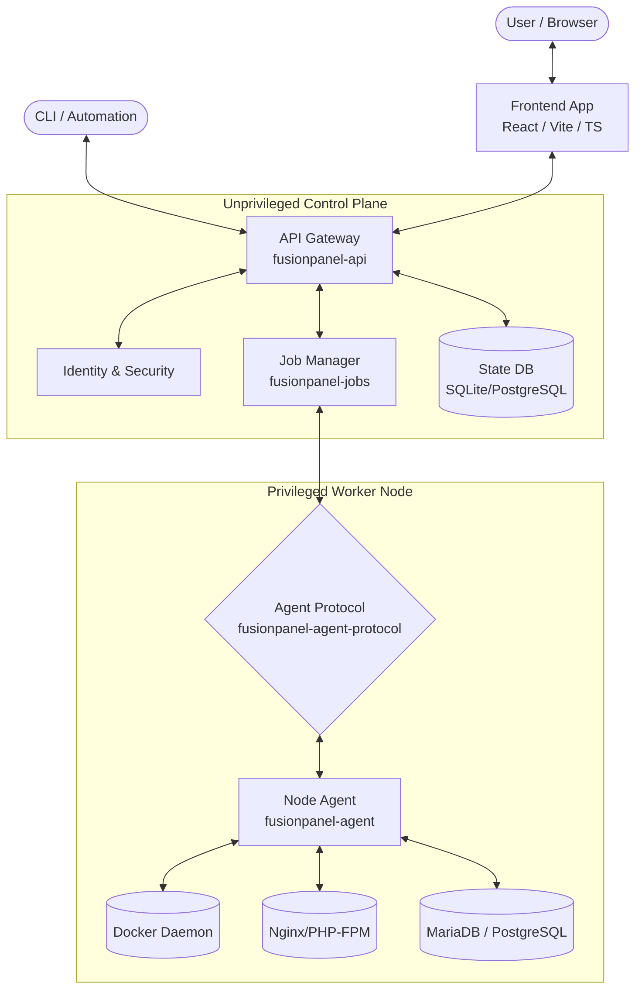

<div align="center">
  
  <h1>FusionPanel</h1>
  <p><strong>The modern, AGPL-3.0-only self-hosted control panel built with Rust, Vite & React.</strong></p>
  <p>Manage websites, containers, databases, DNS, email, security, and operations across one or many nodes through a unified UI, API, and CLI.</p>

  <p>
    <a href="https://github.com/fusionpanel/fusionpanel/actions"></a>
    <a href="https://github.com/fusionpanel/fusionpanel/blob/master/LICENSE"></a>
    <a href="https://rust-lang.org"></a>
    <a href="https://github.com/fusionpanel/fusionpanel/releases"></a>
  </p>
</div>

---

## 🌟 Overview

**FusionPanel** is a lightweight, secure, and highly-performant hosting and server management control panel designed for modern operations. By enforcing strict separation between an unprivileged control plane and a narrowly-scoped node agent, it achieves top-tier security without sacrificing usability.

Whether you're hosting static sites, complex multi-container stacks, or managing vast server fleets, FusionPanel offers granular control out-of-the-box.

---

## 🚀 Key Features

### 🌐 Hosting & Routing
- **Broad App Support**: Native management for PHP-FPM, Node.js, Python, and Static sites.
- **Nginx Native**: Automated virtual hosts, Let's Encrypt TLS (with wildcard certs), redirects, HSTS, and caching (FastCGI/Redis).
- **Resource Constraints**: Disk quotas, bandwidth limits, per-site CPU/RAM constraints.
- **Atomic Provisioning**: All operations employ robust LIFO compensation for atomic success or clean rollback.

### 🐳 Containers & App Catalog
- **Native Docker & Compose**: Manage Docker containers, Compose stacks, and registries directly.
- **One-Click Apps**: Built-in App Catalog templates with automated image update detection.
- **Security & Sandboxing**: CVE scanning, per-image SBOMs, strict isolation policies, and GPU passthrough.

### 🗄️ Databases (Multi-DB)
- **Engines**: Seamlessly manage **MariaDB, MySQL, and PostgreSQL**.
- **Admin Tools**: Integrated SQL browser, schema explorer, and protected phpMyAdmin access.
- **Integrated Backups**: Point-in-time database backups linked to application lifecycle.

### 🛡️ Security, Sandboxing & Admin API
- **Zero-Trust Auth**: TOTP 2FA, Passkeys (WebAuthn), OAuth/SSO, and Role-Based Access Control (RBAC).
- **Hardened Surface**: Web application firewall (WAF), SSH hardening, brute-force & bot protection, and per-user isolation.
- **Headless API**: Comprehensive Administration API with fine-grained API key scopes, IP allowlisting, and rate limiting.

### 🔄 Zero-Downtime Deployments & CI/CD
- **Modern Deployments**: Git push-to-deploy, webhooks, Blue-Green deployments, and pre-commit preview environments.
- **Safe Rollbacks**: Immediate release rollbacks, staging, and two-person approval flows.

### 💾 Backups, S3 & SFTP
- **Storage Integrations**: Native support for S3, Backblaze B2, Google Cloud Storage, and SFTP/FTPS destinations.
- **Reliable Recovery**: Backup encryption, selective restores, and automated restore drills to ensure data integrity.

### 📧 Mail & DNS
- **DNS Management**: DNSSEC, templated zones, and robust zone management.
- **Integrated Mail**: Dovecot virtual mailboxes (sqlx/SQLite), Postfix SMTP, webmail, DKIM/SPF controls, and antispam.

### 📡 Multi-Node Agent
- **Distributed Architecture**: Manage master and worker nodes, move/copy sites between nodes seamlessly.
- **Load-Aware**: Load-aware placement, authenticated RPC, and strict LIFO provisioning.

---

## 🏗️ Architecture

FusionPanel enforces a modern, strict-boundary architecture entirely written in Rust (for the backend) and React/TypeScript (for the UI).



**Core Packages:**
- `fusionpanel-domain`: Validated resource identifiers and lifecycle models.
- `fusionpanel-api`: HTTP health, authenticated capability discovery, configuration.
- `fusionpanel-agent-protocol`: Versioned requests/responses, input validation.
- `fusionpanel-jobs`: SQLite-backed job records, atomic claims, restart persistence.
- `fusionpanel-cli`: HTTP administration client, automated interactions.

---

## ⚡ Quickstart

### Prerequisites
- Linux system (Ubuntu/Debian recommended)
- `curl` and `bash`

### Zero-Dependency Install

We provide a zero-dependency host installer script for easy setup. It adheres strictly to POSIX (`#!/bin/sh`).

```bash
# Download and execute the installer
curl -fsSL https://raw.githubusercontent.com/fusionpanel/fusionpanel/master/packaging/install.sh -o install.sh
chmod +x install.sh
sudo ./install.sh
```

### Starting the API

By default, the API binds to `127.0.0.1:8080`. An admin token is required to boot up.

```bash
# Generate a token and start the server
export FUSIONPANEL_ADMIN_TOKEN=$(openssl rand -hex 32)
export FUSIONPANEL_LISTEN="127.0.0.1:8080"
./fusionpanel-api
```

---

## ⚙️ systemd Service Setup

Production instances should run as a hardened systemd service. Our official unit files implement strict security boundaries (`ProtectSystem=strict`, `ProtectHome=read-only`, `PrivateTmp=true`, `NoNewPrivileges=true`, `MemoryDenyWriteExecute=true`).

Copy the provided unit file:
```bash
sudo cp packaging/systemd/fusionpanel-api.service /etc/systemd/system/
sudo systemctl daemon-reload
sudo systemctl enable --now fusionpanel-api.service
```
*(Note: Ensure `/etc/fusionpanel/config.env` contains your `FUSIONPANEL_ADMIN_TOKEN` and `FUSIONPANEL_LISTEN` variables).*

---

## 🧪 Testing & Benchmarking

Quality assurance is paramount. We rely heavily on isolated End-to-End (E2E) testing against real services.

### Running the Test Suite
The workspace utilizes a shared `Cargo.lock`. Run tests across all workspace packages:

```bash
cargo test --workspace --locked
```

### E2E Testing
E2E tests require Docker and real application binaries. Ensure Docker Compose is available.
If an environment requirement is missing, tests will log `BLOCKED` instead of panicking immediately, ensuring test execution stability.

```bash
# E2E test examples
cargo test --test '*' --features=e2e
```

### Benchmarking
We monitor performance to ensure FusionPanel remains lightweight. Performance tracking guidelines and results can be found in `docs/qualification/performance/`.

---

## 📚 Documentation

Dive deeper into our extensive documentation:

- **[Project Charter](PROJECT_CHARTER.md)**: Core mission and limits.
- **[Capability Catalog](CAPABILITY_CATALOG.md)**: Full 162-item capability inventory.
- **[Architecture & Migration](ARCHITECTURE_AND_MIGRATION.md)**: Complete system design.
- **[Delivery Plan](docs/execution/DELIVERY_PLAN.md)**: Session breakdown and milestones.
- **[Testing Strategy](docs/testing/TEST_STRATEGY.md)**: Real-system validation rules.
- **[Variant Design](docs/engineering/VARIANT_DESIGN.md)**: Selectable workflow modes.
- **[Contributing](CONTRIBUTING.md)**: Rules for pull requests and code style.

---

## ⚖️ License

FusionPanel is licensed under the **AGPL-3.0-only** license. See the [LICENSE](LICENSE) file for details. Note that documentation-only commits must use `+semver: none` in the commit message.

All code interactions and implementations strictly abide by the rules outlined in our `AGENTS.md` and foundation contracts.
